# 角膜曲率校正方法说明

## 1. 文档目的

本文根据 `feature/#1207` 分支的工装程序、`MD810E主分支` 的设备上位机、
两端的 C# 运行时算法，以及 `CurvatureCor260331.m` 整理角膜凸曲率的
标定、配置交付和测量方法。

这里的“校正”分成两个阶段：

1. 出厂标定：使用已知半径的标准模拟眼，生成设备自己的标定参数。
2. 运行时校正：根据实测光斑、环形椭圆长短轴和轴位角，补偿离焦位移并计算曲率半径。
3. 设备测量：加载工装生成的配置，选择稳定图像，融合内外环和多帧结果，生成最终显示值。

本文只讨论正半径的凸曲率，不包含凹曲率的符号和模型处理。


## 2. 相关代码

当前 C# 实现分布在以下位置：

- 标定数据采集和参数生成：
  `LJ.Lus.ToolingDashboard.FullMachine/ViewModel/CurvatureCorrectionViewModel.cs`
- 曲率运行时计算：
  `LJ.Lus.ToolingDashboard.FullMachine/Tool/FunctionMethod.cs` 中的 `EyeCalculator`
- 曲率验证和最终显示值生成：
  `LJ.Lus.ToolingDashboard.FullMachine/ViewModel/CurvatureVerificationViewModel.cs`
- 设备上位机配置模型：
  `LJ.Lus.Backend/Compute/Actors/Algorithm/AlgorithmsConfigs.cs`
- 设备上位机启动配置加载：
  `LJ.Lus/ViewModel/ViewModelLocator.cs`
- 设备上位机曲率运行时算法：
  `LJ.Lus.Backend/Compute/Actors/Algorithm/Calculator/CornealCurvatureCalculator.cs`
- 设备上位机图像筛选、单帧计算和内外环融合：
  `LJ.Lus.Backend/Compute/Actors/Algorithm/AlgorithmActor.cs`
- 设备上位机多帧汇总、补偿和最终 K 值生成：
  `LJ.Lus.Backend/Compute/Actors/DataPostProcess/DataPostProcessActor.cs`
- 设备上位机曲率候选图像采集：
  `LJ.Lus.Backend/Module/MeasureModule/FocusCompensator.cs` 和
  `LJ.Lus.Backend/Module/MeasureModule/CaptureDataModule.cs`
- MATLAB 原始参考：
  `D:/公司/项目/验光仪/角膜曲率/CurvatureCor260331.m`
- MATLAB C# 等价对比程序：
  `D:/公司/项目/验光仪/角膜曲率/CurvatureCor260331_CSharp.m`


## 3. 输入量和符号

| 符号 | 含义 | 单位 |
| --- | --- | --- |
| `R` | 标准模拟眼或待测角膜的曲率半径 | mm |
| `D` | 角膜相对标定零位的轴向位移 | mm |
| `f` | 两个准直光点的中心距离 | mm |
| `dL` | 环形光斑椭圆长轴的完整直径 | mm |
| `dS` | 环形光斑椭圆短轴的完整直径 | mm |
| `theta` | 椭圆长轴的轴位角 | rad |
| `kL` | 长轴直径对位移的变化斜率 | mm/mm |
| `kS` | 短轴直径对位移的变化斜率 | mm/mm |
| `d0L` | `D=0` 时的长轴直径 | mm |
| `d0S` | `D=0` 时的短轴直径 | mm |
| `f0` | `D=0` 时的准直光点距离 | mm |

图像算法输出的是半长轴和半短轴像素值，因此转换关系为：

```text
f  = fDist_px * pixelSize
dL = 2 * semiA_px * pixelSize
dS = 2 * semiB_px * pixelSize
```

当前像元尺寸为 `0.0075 mm/pixel`。


## 4. 方法总览

```mermaid
flowchart TD
    A[三只已知半径标准眼] --> B[每只标准眼扫描21个位移位置]
    B --> C[每个位置提取 f、dL、dS]
    C --> D[分别拟合 f(D)、dL(D)、dS(D)]
    D --> E[生成 f0、kL、kS、CfL、CfS、CL、CS]
    E --> F[按标准眼保存标定节点]
    F --> G[待测眼输入 f、dL、dS、theta]
    G --> H[以当前 f 在标定节点间插值]
    H --> I[估算当前零位直径 d0L、d0S]
    I --> J[反算轴向位移 D]
    J --> K[计算分轴直接曲率]
    K --> L[非球面执行两轮 Euler/轴比融合]
    L --> M[输出 RL、RS、KFlat、KSteep、Cyl]
```


## 5. 出厂标定

### 5.1 标准眼和扫描位置

当前使用三只凸面标准模拟眼：

```text
R = 6.668 mm
R = 7.943 mm
R = 9.320 mm
```

每只标准眼扫描 21 个位置：

```text
D = -1.0, -0.9, ..., 0.0, ..., 0.9, 1.0 mm
```

这里需要区分“代码中的标定坐标”和“电机实际物理位移”：

- C# 的 `D_array` 固定按 21 个点生成 `[-1.0, 1.0]`，没有根据 `MotorDistance` 动态计算。
- 工装当前默认 `MotorDistance=0.1`，因此每步 `0.1 mm`、总范围 `2.0 mm` 时，
  `D_array` 才与实际毫米位移一致。
- `D=0` 对应扫描开始前确定的清晰参考位置；标定时先从该位置移动到 `D=-1.0`，
  再按扫描顺序逐步移动到 `D=1.0`。
- `D` 的正负方向由 `_motorDirection` 和扫描顺序共同决定，不是独立于机构方向的通用光学符号。
- 如果修改 `MotorDistance` 或扫描点数，必须同步修改 `D_array` 的物理坐标，否则 `kL/kS`
  和运行时反算的 `D` 将不再以正确的毫米尺度表示。

`CurvatureCor260331.m` 的部分注释仍写“11点”，但实际 `D_array` 同样包含21个点，
应以代码中的数组为准。

内环和外环分别生成一套长短轴参数，但共用同一个准直光点距离 `f` 和同一个
`f0`。


### 5.2 每个位置的数据稳定化

C# 工装程序在每个电机位置采集 9 帧，而不是直接使用单帧结果。

对于 `f`、内环长短轴、外环长短轴，处理过程为：

1. 丢弃 `NaN`、`Infinity` 和小于等于零的值。
2. 将剩余值升序排列。
3. 取长度为 `(n+1)/2` 的连续滑动窗口；9个有效值时窗口长度为5。
4. 找到极差最小的窗口。
5. 使用该窗口内数据的平均值作为当前位置的测量值。

这个步骤用于降低单帧波动对后续线性标定的影响。


### 5.3 线性模型

对于每只标准眼和每个环，建立以下线性模型：

```text
f(D)  = kf * D + f0
dL(D) = kL * D + d0L
dS(D) = kS * D + d0S
```

其中：

- `f0`、`d0L`、`d0S` 是回归直线的截距，不直接使用某一个零位样本。
- `kL`、`kS` 表示长短轴直径对离焦位移的灵敏度。
- 当前运行时算法不使用 `kf`，但标定时仍拟合 `f(D)`，以获得更稳定的 `f0`。


### 5.4 C# 鲁棒线性拟合

`CurvatureCor260331.m` 使用普通 `polyfit`。当前 C# 在普通最小二乘的基础上增加了一次离群点过滤：

1. 使用全部有效点做第一次线性拟合。
2. 计算每个点的绝对残差：

```text
ei = abs(yi - yFit_i)
```

3. 计算绝对残差的均值和总体标准差：

```text
meanError = mean(ei)
sigma = sqrt(sum((ei - meanError)^2) / n)
```

4. 保留满足以下条件的点：

```text
ei <= meanError + 1.5 * sigma
```

5. 如果确实剔除了点，并且至少剩余两个点，则再拟合一次。
6. 不继续迭代。

拟合 `dL` 或 `dS` 时，只有同一位置的 `dL`、`dS`、`f` 都是有限正数，
该位置才进入正值拟合。这保证长短轴使用一致的位置集合。

代码还保留一个异常回退分支：如果正值点不足两个，则改用所有有限值重新尝试拟合，
此时零值或负值也可能参与。如果连有限值也不足两个，当前标准眼标定直接失败。
正常校正数据不应依赖这个回退分支。


### 5.5 标定参数

线性拟合完成后，为每个环计算：

```text
CfL = d0L / f0
CfS = d0S / f0

CL = d0L / R
CS = d0S / R
```

这些参数分别承担两种转换：

```text
d0L = CfL * f
d0S = CfS * f

RL = dL_corrected / CL
RS = dS_corrected / CS
```

`CfL/CfS` 将当前光点距离 `f` 转换成当前条件下的零位环直径；
`CL/CS` 将完成位移补偿后的环直径转换成曲率半径。

长短轴分开计算参数，可以保留设备在两个方向上的固有不对称。


### 5.6 标定节点

每只标准眼生成一个节点，核心数据为：

```text
R, f0

Inner: CfL, CfS, kL, kS, CL, CS
Outer: CfL, CfS, kL, kS, CL, CS
```

当前 `CalibrationNode` 沿用了旧模型字段名，实际映射为：

| 旧字段 | 260331 实际含义 |
| --- | --- |
| `C` | `d0L` |
| `scale_L` | `d0S` |
| `scale_S` | `CfL` |
| `kL2` | `CfS` |
| `kL1` | `kL` |
| `kS2` | `kS` |
| `kS1` | `CL` |
| `kk2` | `CS` |
| `kk1` | 模型标记 `260331` |

节点字段以 `float` 保存。运行时读取后再转换成 `double` 参与计算。

`d0L/d0S` 会随标定节点保存，但当前 `Calculate260331` 运行时不直接插值这两个字段；
运行时实际使用的是 `CfL/CfS`，并通过 `Cf * f` 重新估算当前条件下的零位直径。


## 6. 运行时曲率校正

### 6.1 标定数据前置条件

调用 `EyeCalculator.Calculate` 前，标定数据必须满足：

1. `FactoryInterpolationDictionary` 不为空。
2. 至少包含3个标准眼节点。
3. 当前使用的内环或外环在所有节点中都带有 `260331` 模型标记。

如果节点少于3个，运行时直接拒绝计算；如果存在旧版或混合版本节点，则提示当前
`CorrectFileConfigs.json` 不是 260331 新版数据，需要重新完成曲率校正。


### 6.2 以光点距离为插值轴

运行时不先猜测曲率半径，而是直接使用当前测得的 `f` 作为查询坐标。

首先将三只标准眼节点按 `f0` 升序排列，然后分别插值：

```text
CfL(f), CfS(f)
kL(f),  kS(f)
CL(f),  CS(f)
```

插值区间内部使用线性插值；超出范围时，使用最靠近边界的两个节点做线性外推。

这种设计消除了“必须先知道 R 才能选标定参数”的循环依赖。


### 6.3 估算当前零位直径

使用插值得到的 `CfL` 和 `CfS`：

```text
d0L_est = CfL * f
d0S_est = CfS * f
```

`d0L_est/d0S_est` 表示在当前光点距离下，如果待测眼正好处于标定零位，
理论上应该测得的长短轴直径。


### 6.4 球面判断

当前 C# 以长短轴物理直径差判断是否近似球面：

```text
isSpherical = abs(dL - dS) < 0.005 mm
```

球面时强制：

```text
theta = 0
```

这里判断的是几何长短轴差，而不是判断传入角度是否为零。因此，存在散光但轴位恰好为
`0 deg` 时，C# 仍会进入非球面分支。


### 6.5 球面情况下反算位移

近似球面时使用长短轴均值通道：

```text
dSpot  = (dL + dS) / 2
d0Spot = (d0L_est + d0S_est) / 2
kSpot  = (kL + kS) / 2
```

位移为：

```text
D = (dSpot - d0Spot) / kSpot
```


### 6.6 非球面情况下反算位移

非球面时使用轴位角参与 Euler 加权：

```text
c2 = cos(theta)^2
s2 = sin(theta)^2
```

等效环直径采用调和形式：

```text
dSpot  = 1 / (c2/dL      + s2/dS)
d0Spot = 1 / (c2/d0L_est + s2/d0S_est)
```

位移灵敏度采用线性角度权重：

```text
kSpot = c2 * kL + s2 * kS
```

最终仍使用：

```text
D = (dSpot - d0Spot) / kSpot
```

这一步的目的，是在反算整体轴向位移时降低散光量对位移估计的污染。


### 6.7 分轴直接曲率

得到位移 `D` 后，分别消除长短轴的位移分量：

```text
RL_direct = (dL - kL * D) / CL
RS_direct = (dS - kS * D) / CS
```

对于球面数据，C# 到这里结束，直接输出这两个结果。


## 7. C# 的两轮 Euler/轴比融合

原始 `CurvatureCor260331.m` 在计算 `RL_direct/RS_direct` 后直接返回。
当前 C# 对非球面数据增加了两轮融合。


### 7.1 当前基准半径和轴比

先按当前 `f` 在三个标定节点的已知半径 `R` 之间插值得到：

```text
RSpot = interp(f0_vector, R_vector, f)
```

测量轴比定义为：

```text
r = dL / dS
```


### 7.2 第一组 Euler 半径

```text
RL_euler = RSpot * (c2 + r * s2)
RS_euler = RSpot * (c2/r + s2)
```


### 7.3 第一轮融合

```text
RL_pass1 = c2 * RL_direct + s2 * RL_euler
RS_pass1 = s2 * RS_direct + c2 * RS_euler
```


### 7.4 根据第一轮结果再次施加轴比

```text
RL_euler2 = RS_pass1 * r
RS_euler2 = RL_pass1 / r
```


### 7.5 第二轮融合和最终结果

```text
RL_final = c2 * RL_direct + s2 * RL_euler2
RS_final = s2 * RS_direct + c2 * RS_euler2
```

只有满足以下条件时执行两轮融合：

```text
not isSpherical
dL > 1e-9
dS > 1e-9
```

否则：

```text
RL_final = RL_direct
RS_final = RS_direct
```


## 8. 输出半径和 K 值

采用角膜折射常数 `337.5`：

```text
K1 = 337.5 / RL_final
K2 = 337.5 / RS_final

KFlat  = min(K1, K2)
KSteep = max(K1, K2)
Cyl    = abs(K1 - K2)
```

半径单位为毫米，K值单位为屈光度 `D`。

需要注意，`EyeCalculator` 没有按照最终半径的数值大小重新排序，而是直接映射：

```text
RMajor = RL_final
RMinor = RS_final
```

因此，当前字段名表示长轴和短轴计算通道，不保证数值一定满足
`RMajor >= RMinor`。只有 `KFlat/KSteep` 使用 `min/max` 按K值大小排序。


## 9. 验证程序的最终显示值

验证界面不是直接显示某一个环、某一帧的 `EyeCalculator` 输出。

对每一帧有效测量：

1. 内环单独调用一次 `EyeCalculator`。
2. 外环单独调用一次 `EyeCalculator`。
3. 对内外环半径取均值：

```text
fusedMajor = (inner.RMajor + outer.RMajor) / 2
fusedMinor = (inner.RMinor + outer.RMinor) / 2
```

这里的 `Major/Minor` 仍表示对应计算通道；内外环融合前后都没有按半径大小重新排序。

多帧结果生成最终显示值时：

1. 至少需要3帧有效结果。
2. 按每帧的平均半径 `(RMajor + RMinor)/2` 排序。
3. 在排序结果中寻找平均半径方差最小的连续3帧。
4. 对这3帧的 `RMajor/RMinor` 分别求平均。
5. 最终半径以3位小数显示。

因此，比较 MATLAB 和工装界面时，需要区分以下三个层级：

```text
单环单帧 EyeCalculator 结果
内外环融合后的单帧结果
稳定3帧平均后的界面最终结果
```


## 10. 与 CurvatureCor260331.m 的关系

两者共同的基础模型是：

- 21个位移扫描点。
- 分别线性拟合 `f/dL/dS`。
- 使用 `f0` 作为插值坐标。
- 分轴计算 `CfL/CfS` 和 `CL/CS`。
- 使用 `Cf * f` 估算当前零位直径。
- 通过轴位角加权反算位移。
- 使用 `(d-kD)/C` 计算分轴直接曲率。

主要差异如下：

| 项目 | MATLAB 260331 | 当前 C# |
| --- | --- | --- |
| 每个位置输入 | 一张图片的提取结果 | 9帧稳定正值均值 |
| 线性拟合 | 普通 `polyfit` | 正值过滤加一次1.5 sigma离群点重拟合 |
| 参数保存精度 | `double` | `CalibrationNode` 字段为 `float` |
| 标准节点顺序 | 使用结构体当前顺序 | 按 `f0` 升序排序 |
| 球面分支条件 | 最终以 `theta == 0` 选择均值通道 | 以 `abs(dL-dS) < 0.005` 选择均值通道 |
| 分轴直接曲率 | 有 | 有 |
| 两轮 Euler/轴比融合 | 无 | 非球面时执行 |
| 验证最终值 | 分别报告内外环 | 内外环融合，再选择稳定3帧平均 |

因此，可以把当前 C# 理解为：

```text
MATLAB 260331 的线性分轴模型
+ 更鲁棒的标定拟合
+ 以长短轴物理差为依据的球面分支条件
+ 非球面两轮 Euler/轴比融合
+ 工装端多帧稳定化和内外环结果融合
```


## 11. 数据对比建议

为了确定差异来自哪一层，建议分阶段对比，而不是只比较最终曲率。


### 11.1 固定输入特征

首先固定完全相同的：

```text
semiA_px
semiB_px
fDist_px
angleDeg
```

如果直接从图片分别运行 MATLAB 和 C# 图像算法，图像提取差异会混入曲率算法差异。


### 11.2 对比标定参数

每只标准眼、每个环记录：

```text
f0
d0L, d0S
kL, kS
CfL, CfS
CL, CS
```

先确认普通拟合、鲁棒拟合和单精度存储分别造成多少差异。


### 11.3 对比运行时中间量

对每一组输入依次记录：

```text
插值后的 CfL, CfS, kL, kS, CL, CS
d0L_est, d0S_est
isSpherical, theta, c2, s2
dSpot, d0Spot, kSpot
D
RL_direct, RS_direct
RSpot, r
RL_pass1, RS_pass1
RL_final, RS_final
```

这样可以明确差异是来自位移反算、直接曲率，还是两轮融合。


### 11.4 与界面值比较时补齐工装流程

如果目标是复现工装界面最终显示值，还必须补齐：

- 每个位置9帧稳定均值。
- C# 标定参数的 `float` 保存精度。
- 验证输入字段的 `float` 精度。
- 运行时 `PixelSize=0.0075` 的 `double` 精度。
- 内外环半径平均。
- 多帧中方差最小的连续3帧平均。

`CurvatureCor260331_CSharp.m` 当前主要用于同一组 MATLAB 图像特征下的单环算法对比，
并不等同于完整工装界面的最终显示流程。


## 12. 核心结论

当前曲率校正的核心不是直接建立“像素到曲率”的单一比例，而是：

1. 使用标准眼建立环直径随离焦位移变化的分轴线性模型。
2. 使用当前光点距离 `f` 选择和插值设备标定参数。
3. 通过 `Cf * f` 估算当前条件下的零位环直径。
4. 利用长短轴和轴位角反算统一的轴向位移 `D`。
5. 分别消除长短轴中的位移影响，再换算成曲率半径。
6. 对非球面结果使用两轮 Euler/轴比融合。
7. 工装验证阶段再执行内外环融合和多帧稳定选择。

其中，`D` 的准确性是位移补偿的关键。如果位移反算受到散光量污染，长短轴直接曲率
会同时产生系统偏差；260331 引入轴位角加权，主要作用是降低这种污染。

C# 的两轮 Euler/轴比融合发生在 `D` 和 `RL_direct/RS_direct` 已经计算完成之后，
不会回写或修正 `D`。它的作用是将分轴直接曲率与当前 `RSpot`、实测轴比以及轴位权重
进一步融合，调整最终输出的 `RL_final/RS_final`。


## 13. MD810E 设备上位机测量链路

本节描述 `MD810E主分支` 中 `LJ.Lus` 的实际测量流程。工装程序和设备上位机
职责不同：工装负责生成设备专属标定参数，上位机只负责加载这些参数并用于测量。


### 13.1 工装与设备的职责边界

```mermaid
flowchart LR
    A[1207 工装程序] --> B[三只标准眼、21 点扫描]
    B --> C[生成 FactoryInterpolationDictionary]
    C --> D[保存 CorrectFileConfigs.json]
    D --> E[部署到设备上位机运行目录]
    E --> F[LJ.Lus 启动加载]
    F --> G[选择曲率候选图像]
    G --> H[提取内外环和光点特征]
    H --> I[CornealCurvatureCalculator 单帧计算]
    I --> J[内外环融合]
    J --> K[入选帧汇总与补偿]
    K --> L[输出半径、K 值和轴位]
```



`LJ.Lus` 不重新拟合标准眼数据。它要求运行目录中的 `CorrectFileConfigs.json`
已经由新版工装生成，并包含可直接使用的 260331 标定节点。


### 13.2 配置文件部署和启动加载

上位机从当前工作目录读取：

```text
<LJ.Lus 运行目录>/CorrectFileConfigs.json
```

启动时的加载过程为：

1. `ViewModelLocator` 在 `SimpleIoc` 中注册单例 `CorrectFileConfigs`。
2. 如果当前目录存在 `CorrectFileConfigs.json`，使用 `JsonHelper.Load<CorrectFileConfigs>`
   反序列化。
3. 使用 `ClassCloneHelper.Copy` 将文件内容复制到 IOC 单例，而不是让算法模块各自读取文件。
4. `AlgorithmsConfigs.ReadConfigs()` 从 `ServiceLocator` 取得同一个单例，并放入
   `CorrectFileConfigs[0]`。
5. `AlgorithmActor` 构造 `CalibrationParams` 时，从 `CorrectFileConfigs[0]` 取得
   `FactoryInterpolationDictionary`，传给 `CornealCurvatureCalculator`。

当前曲率算法只使用第一个校正文件中的标定字典：

```text
_algorithmsConfigs.CorrectFileConfigs[0].FactoryInterpolationDictionary
```

它不依赖当前 A-scan 信号属于第几个面。`PixelSize` 在四个生产调用入口中固定传入
`0.0075 mm/pixel`，没有从 JSON 的 `Pixel` 字段动态读取。因此，工装生成参数时也必须
使用相同像元尺寸。


### 13.3 上位机接受的配置条件

`CornealCurvatureCalculator.Calculate` 在计算前要求：

1. `FactoryInterpolationDictionary` 不为 `null`。
2. 字典至少包含3个标准眼节点。
3. 当前计算内环时，所有节点的 `Inner_kk1` 必须约等于 `260331`。
4. 当前计算外环时，所有节点的 `Outer_kk1` 必须约等于 `260331`。

判断容差为：

```text
abs(marker - 260331) < 0.5
```

不满足条件时会直接抛出异常，不会自动回退到旧曲率算法。因此旧版
`CorrectFileConfigs.json` 不能用于当前生产算法。

配置节点中的复用字段与实际参数映射仍为：

| `CalibrationNode` 字段 | 260331 实际含义 |
| --- | --- |
| `C` | `d0L` |
| `scale_L` | `d0S` |
| `scale_S` | `CfL` |
| `kL2` | `CfS` |
| `kL1` | `kL` |
| `kS2` | `kS` |
| `kS1` | `CL` |
| `kk2` | `CS` |
| `kk1` | 模型标记 `260331` |

内环使用 `Inner_*` 字段，外环使用 `Outer_*` 字段。上位机运行时实际参与计算的是
`CfL/CfS/kL/kS/CL/CS`；保存的 `d0L/d0S` 主要用于追溯，运行时通过 `Cf*f`
重新估算当前零位直径。


### 13.4 曲率候选图像采集

对焦过程中，`FocusCompensator` 调用 `HandleLightSpotCompute`。该入口使用外环
`D_Shift` 作为当前离焦距离，同时返回内环中心坐标。只有满足以下条件时，才把虹膜
图像副本和离焦距离保存到 `CaptureDataModule` 的曲率候选集合：

```text
测量模式为 AK 或 AScan
曲率候选图像采集已启用
当前不在蓝灯测量
D_Shift != 0
abs(D_Shift) < 0.4 mm
xDiff^2 + yDiff^2 <= 5^2 pixel^2
```

此外，对焦入口还会检查中心是否位于有效范围，并过滤相邻帧中心跳变过大的坏帧。

当信号任务的峰数统一为2或5且候选集合不为空时，`AlgorithmActor` 启用独立曲率图像
流程，并执行两级筛选：

1. 过滤空图像和尺寸不是 `640*480` 的图像。
2. 按 `abs(Distance)` 从近焦到远焦排序，最多保留前50帧。
3. 候选数不超过5时全部保留；超过5时，粗选数量先取候选数的一半，再限制为
   至少5帧、最多25帧。
4. 对粗选图像先执行一次完整曲率计算，排除图像算法返回 `<0` 或 `4` 的帧。
5. 从有效结果中选择最多5帧，使以下总方差最小：

```text
score = Var(RLong) + Var(RShort)
```

6. 如果多组子集得分相同，选择 `sum(abs(Distance))` 更小的一组。

这里的生产上位机策略与工装验证界面的“连续3帧最小方差”不同。生产程序最终使用
最多5帧，而且候选子集不要求在采集序列中连续。

如果信号任务的峰数不统一、不是2/5、候选集合为空，或者候选图像无法形成有效结果，
程序会退回原来的信号任务图像计算流程。此时用于曲率汇总的帧数由信号任务集合决定，
不保证恰好是5帧。


### 13.5 单帧图像特征

每张入选图像调用 `CornealCurvatureNewCompute`，得到两个长度为5的数组和一个光点距离：

| 输出 | 含义 |
| --- | --- |
| `inner[0]`, `inner[1]` | 内环中心坐标，像素 |
| `inner[2]` | 内环椭圆半长轴，像素 |
| `inner[3]` | 内环椭圆半短轴，像素 |
| `inner[4]` | 内环长轴轴位角，度 |
| `outer[0]`, `outer[1]` | 外环中心坐标，像素 |
| `outer[2]` | 外环椭圆半长轴，像素 |
| `outer[3]` | 外环椭圆半短轴，像素 |
| `outer[4]` | 外环长轴轴位角，度 |
| `lightSpotDistance` | 两个准直光点的中心距离，像素 |

同一帧的内环和外环共用 `lightSpotDistance`，但分别使用自己的长短轴和轴位角。

图像质量返回码含义为：

| 返回码 | 当前注释含义 |
| --- | --- |
| `-1` | 靶环区域提取失败 |
| `0` | 计算准确 |
| `1` | 光斑点数不是严格32个，可能不准确 |
| `2` | 内环光斑面积标准差较大 |
| `3` | 外环光斑面积标准差较大 |
| `4` | 光斑点数少于10个，计算不准确 |

候选帧筛选路径和自动对焦入口明确排除 `<0` 和 `4`；`1/2/3` 仍允许进入后续
稳定性选择或对焦计算。


### 13.6 单环单帧曲率计算

`AlgorithmActor` 对同一帧调用两次 `CornealCurvatureCalculator.Calculate`：

```text
内环：IsInnerRing = true
外环：IsInnerRing = false
```

传入顺序均为：

```text
semiA_px, semiB_px, lightSpotDistance_px, angleDeg, calibrationParams
```

计算器先转换为毫米，再执行第6至第8节描述的 260331 算法。生产类名是
`CornealCurvatureCalculator`，工装类名是 `EyeCalculator`，两者的核心参数插值、
位移反算、分轴直接曲率和两轮 Euler/轴比融合相同。

单环输出为：

```text
RMajor  = RL_final
RMinor  = RS_final
KFlat   = min(337.5/RMajor, 337.5/RMinor)
KSteep  = max(337.5/RMajor, 337.5/RMinor)
Cyl     = abs(K1-K2)
D_Shift = 反算离焦位移
```


### 13.7 单帧内外环融合

生产程序没有直接使用计算器返回的单环 `KFlat/KSteep`，而是先融合半径：

```text
RLong_frame  = (inner.RMajor + outer.RMajor) / 2
RShort_frame = (inner.RMinor + outer.RMinor) / 2
```

如果：

```text
abs(RLong_frame - RShort_frame) <= 0.03 mm
```

则把两个半径都替换为均值，作为球面结果。主测量路径还会把长轴轴位角设置为0。
否则，单帧轴位取内环的 `inner[4]`。

同时，程序把每帧的光点距离、内外环原始像素长短轴、轴位角和单环半径保存到
`CornealCurvatureComputeResult`，用于问题数据导出和算法追溯。


### 13.8 多帧后处理和最终输出

`DataPostProcessActor` 优先使用标记为 `UseForCornealCurvature` 的结果。独立曲率候选
图像流程正常时最多5帧；走回退流程时使用当前有效信号任务结果，数量可能不同。
最终半径的处理顺序为：

1. 对每帧的 `RLong_frame` 和 `RShort_frame` 分别加设备配置中的
   `CornealCurvatureCompensationFactor`。该补偿量单位为毫米。
2. 对所有有效入选帧分别求算术平均，得到最终长轴和短轴半径。
3. 对轴位角做180度周期下的平均，得到最终长轴轴位。
4. 如果最终两半径差小于等于 `0.03 mm`，再次强制为球面均值，并把轴位设置为0。
5. 计算中间平均半径，并先用于轴长/角膜曲率半径比 `AL/CR`：

```text
RMean = (RLong + RShort) / 2
AL/CR = AxialLength / RMean
```

6. 将最终半径换算为两个方向的 K 值：

```text
D1 = 337.5 / RShort
D2 = 337.5 / RLong
```

7. 随后 `CornealCurvatureMeanValue` 被覆盖为平均屈光度；界面中的 `AVG_K` 是：

```text
AVG_K = (D1 + D2) / 2
```

   因此 `CornealCurvatureMeanValue` 在后处理内部先临时保存 `RMean`，方法返回时保存的
   则是 `AVG_K`，不能按字段名把两个阶段混为同一个物理量。
8. 最终半径超出 `6.5~9.5 mm` 时进入异常值处理，不作为正常角膜曲率显示。

因此，上位机界面最终值对应的层级为：

```text
单环单帧 260331 结果
→ 单帧内外环半径平均
→ 入选稳定帧平均（正常独立流程最多5帧）
→ 设备半径补偿
→ 0.03 mm 球面归并
→ 半径到屈光度换算
```


### 13.9 自动对焦使用的曲率位移

`HandleLightSpotCompute` 使用外环调用同一计算器，并返回：

```text
outerResult.D_Shift
```

这个值供 Y 轴对焦补偿使用，不是最终显示曲率。也就是说，260331 的位移反算既参与
曲率补偿，也直接参与设备对焦闭环。


### 13.10 部署和实现注意事项

1. 工装生成的新 `CorrectFileConfigs.json` 必须部署到 `LJ.Lus` 当前运行目录。
2. 安装或升级时不能用不含 `FactoryInterpolationDictionary` 的模板文件覆盖设备标定文件。
3. 三个节点的内外环 `260331` 标记必须完整；只标定一个环同样无法完成全部测量。
4. 工装和上位机必须共同使用 `0.0075 mm/pixel`。
5. 当前生产算法只讨论并实现新版凸曲率路径；旧凹曲率计算调用已被注释。
6. 候选帧筛选和自动对焦入口会拒绝图像质量码 `<0` 和 `4`。部分旧的逐帧计算入口
   仍未统一检查该返回码；这些路径同时承担 AL/CCT 等多参数计算，不能在缺少完整回归
   验证时简单跳过整帧。这是调用层仍需处理的质量门控问题，不是 260331 公式本身的差异。

